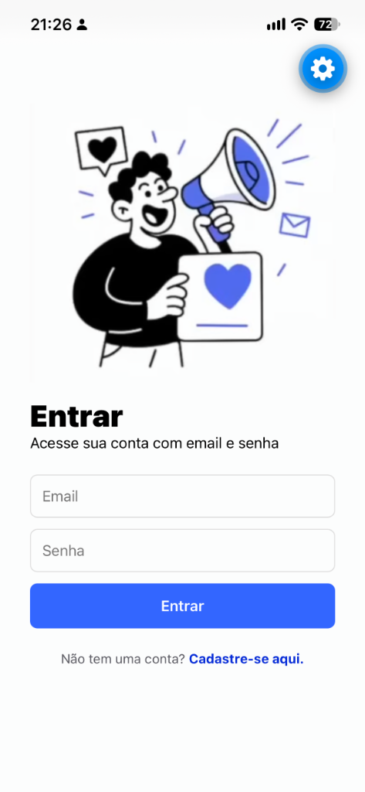
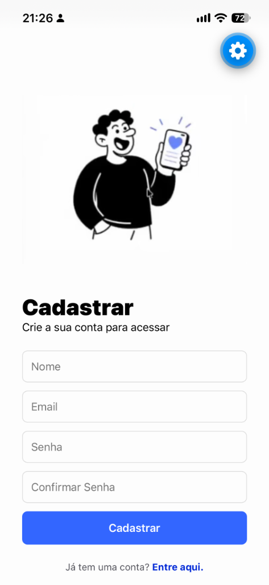

# MyApp Mobile 📱

> 🎓 **Projeto de Treinamento / Aprendizado**: Este aplicativo foi desenvolvido com fins didáticos para estudo prático de desenvolvimento mobile com **React Native**, **Expo (SDK 58)** e **Expo Router**.

---

## 📸 Demonstração das Telas

<p align="center">
  
  &nbsp;&nbsp;&nbsp;&nbsp;
  
</p>

---

## 🚀 Funcionalidades

- **Tela de Login (`/`)**:
  - Formulário com validação de preenchimento de e-mail e senha.
  - Alerta de feedback ao usuário com `Alert.alert`.
  - Link de navegação direta para a tela de cadastro.
- **Tela de Cadastro (`/singup`)**:
  - Formulário completo para novos usuários (Nome, E-mail, Senha e Confirmação de Senha).
  - Máscara de segurança para campos de senha (`secureTextEntry`).
  - Teclado otimizado para e-mail (`keyboardType="email-address"`).
  - Link de retorno para a tela de login.
- **Experiência do Usuário (UX/Mobile)**:
  - Layout responsivo utilizando `KeyboardAvoidingView` e `ScrollView` para não sobrepor campos com o teclado virtual.
  - Navegação nativa por pilha sem cabeçalho padrão (`Stack screenOptions={{ headerShown: false }}`).
  - Componentes modulares e reutilizáveis estilizados via `StyleSheet`.

---

## 📁 Estrutura do Projeto

```text
myapp-mobile/
├── assets/
│   ├── images/               # Ícones nativos e splash screen
│   └── screenshots/          # Capturas de tela utilizadas no README
│       ├── login.png
│       └── signup.png
├── src/
│   ├── app/                  # Rotas e páginas (Expo Router)
│   │   ├── _layout.tsx       # Configuração do Stack Navigator
│   │   ├── index.tsx         # Tela inicial de Login (Entrar)
│   │   └── singup.tsx        # Tela de Criação de Conta (Cadastrar)
│   ├── assets/               # Imagens e ilustrações da aplicação
│   │   ├── img1.png          # Ilustração da tela de Login
│   │   └── img2.png          # Ilustração da tela de Cadastro
│   └── components/           # Componentes customizados e reutilizáveis
│       ├── Button.tsx        # Botão padrão com estilos e propriedades
│       └── input.tsx         # Campo de entrada de texto padronizado
├── app.json                  # Manifesto e configurações gerais do Expo
├── package.json              # Dependências e scripts do projeto
└── tsconfig.json             # Configurações do TypeScript
```

---

## 🛠️ Tecnologias Utilizadas

- **[React Native](https://reactnative.dev/)** `0.88`
- **[React](https://react.dev/)** `19.3`
- **[Expo](https://expo.dev/)** `SDK 58`
- **[Expo Router](https://docs.expo.dev/router/introduction/)** `~58.0` (Roteamento baseado em arquivos)
- **[TypeScript](https://www.typescriptlang.org/)**

---

## 💻 Como Rodar o Projeto

### Pré-requisitos
- Node.js instalado (versão LTS recomendada).
- Aplicativo **Expo Go** instalado no seu dispositivo físico (iOS ou Android) ou emulador configurado.

### Passo a passo

1. **Clone o repositório:**
   ```bash
   git clone <URL_DO_REPOSITORIO>
   cd myapp-mobile
   ```

2. **Instale as dependências:**
   ```bash
   npm install
   ```

3. **Inicie o servidor de desenvolvimento:**
   ```bash
   npx expo start -c
   ```

4. **Abra o aplicativo:**
   - **Dispositivo físico**: Escaneie o QR Code exibido no terminal utilizando a câmera (iOS) ou o app **Expo Go** (Android).
   - **Emulador/Simulador**: Pressione `i` para abrir no simulador iOS ou `a` para abrir no emulador Android.
